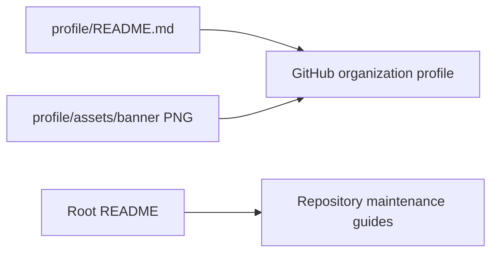

# Global Platforms Labs public profile

## Purpose

- Maintain the public organization introduction and its banner.
- Keep the profile focused on identity, affiliation and public navigation.
- This repository contains static content. It has no application backend or deployment service.

## Architecture

### System Diagram

- GitHub consumes `profile/README.md` for the public organization profile.
- The root `README.md` explains this repository; it is a separate entry point.
- The profile embeds the banner using its public raw GitHub URL.
- Repository changes do not automatically change organization settings such as the avatar or description.

### Tech Stack

| Item | Use |
|---|---|
| Markdown and embedded HTML | Profile content and layout |
| PNG | Public banner |
| Git and GitHub | Version history, pull requests and profile rendering |

## Modules

| Module | Description | Documentation |
|---|---|---|
| Public profile | Content, image and repository navigation | [Profile module](modules/profile.md) |

## Key Features

| Feature | Description | Documentation |
|---|---|---|
| Profile publication | Reviewed source becomes the organization introduction | [Publication](features/publication.md) |

## Development

### Setup

- Clone `Global-Platforms-Labs/.github` with an account that has the required repository access.
- Read the [maintenance workflow](maintenance.md).
- Use a separate branch for edits. No package installation is required.

### Build & Run

- There is no build command or local server.
- Preview Markdown and inspect the image at the intended display width.
- GitHub's organization page is the final rendering surface.

### Testing

- Resolve relative file links and inspect HTML image/link attributes.
- Check `git diff --check` and the final changed-file list.
- After merge, read the saved source and verify the rendered public profile if profile content changed.
- A valid link does not establish correct image rendering or organization settings.

## References

- [Profile source](../profile/README.md)
- [Maintenance workflow](maintenance.md)
- [GitHub organization-profile documentation](https://docs.github.com/en/organizations/collaborating-with-groups-in-organizations/customizing-your-organizations-profile)
